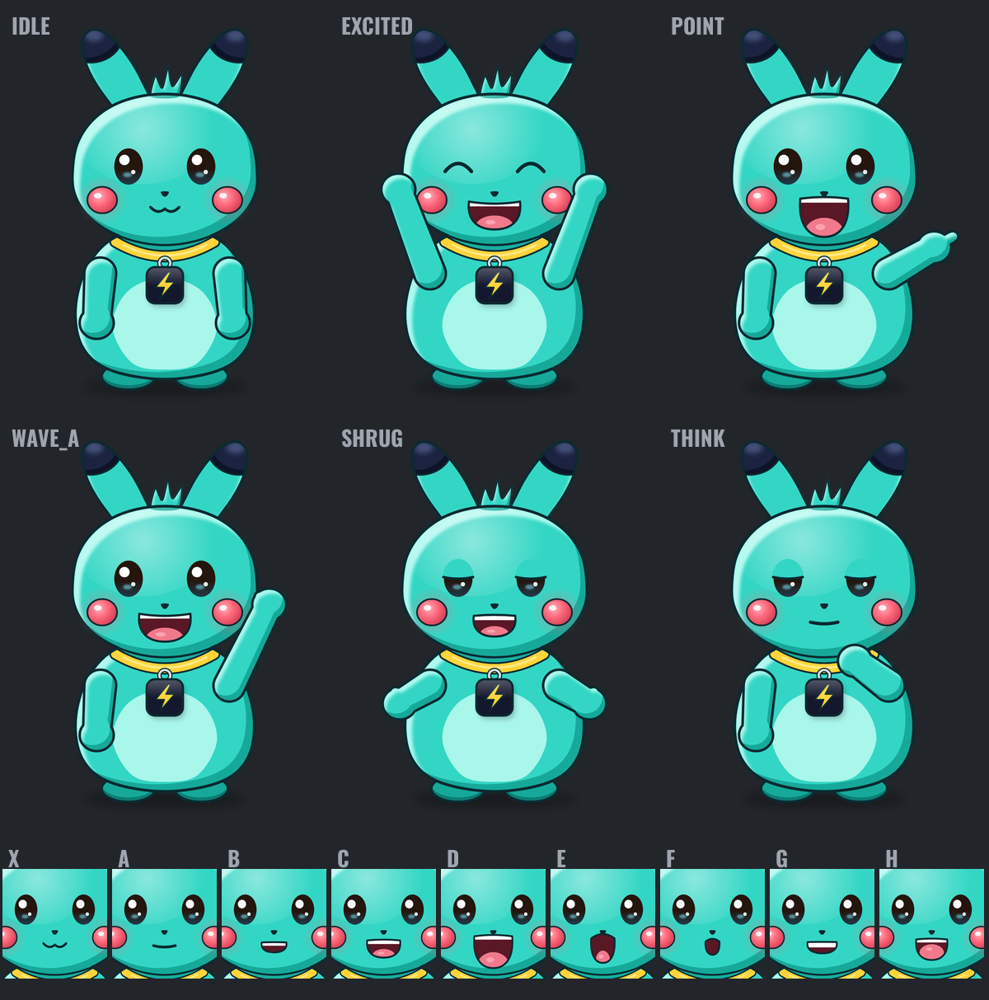
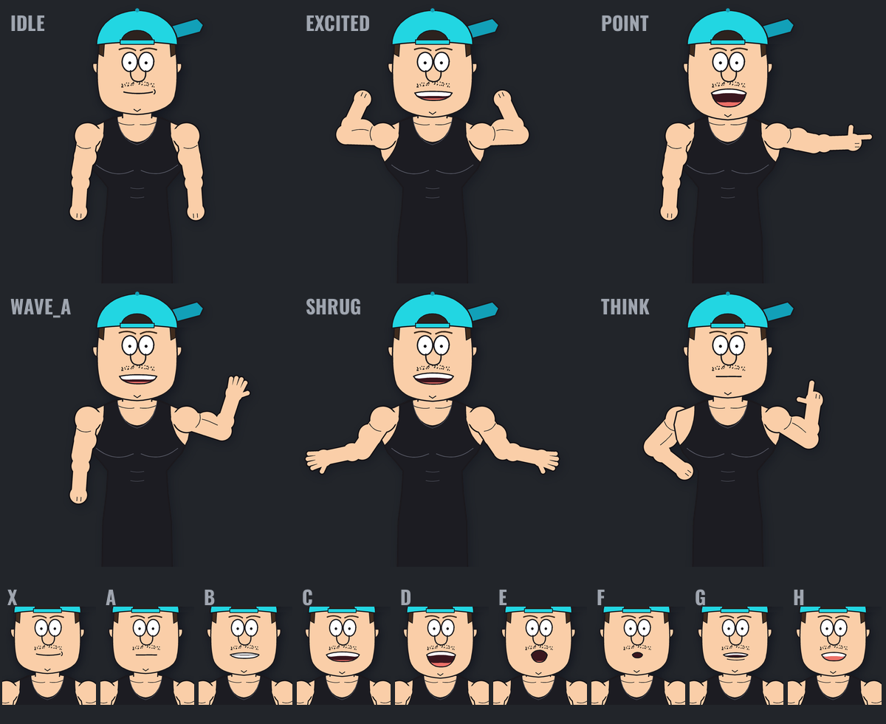
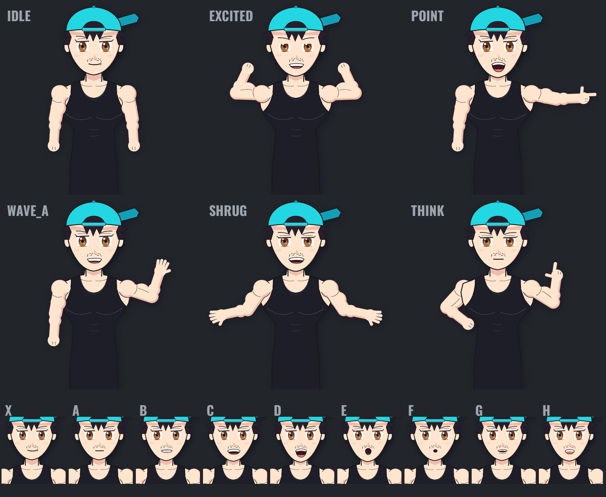
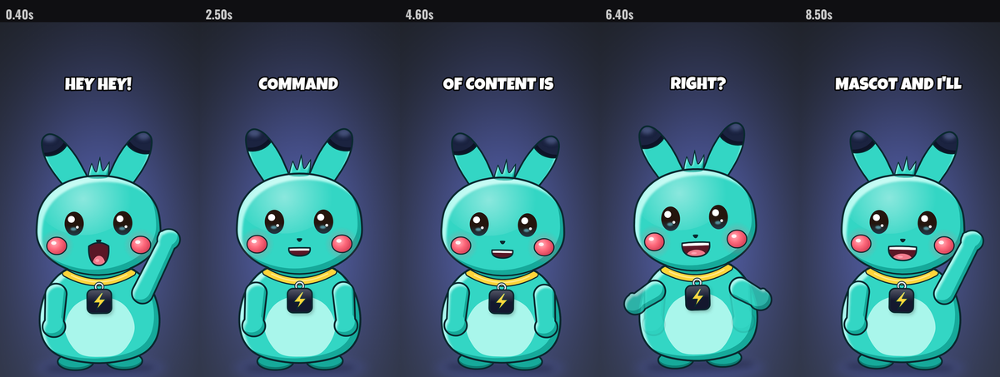

# Claude Codes Influencers

**Build a talking mascot that turns any script into a vertical video. Free, open source, no credits.**

You write the line. The mascot says it with a real voice, lip-syncs every word, reacts to keywords with poses,
blinks, bounces to the audio and gets captions. It outputs a 1080x1920 mp4 ready for Reels, TikTok and Shorts.

Fork the repo, add your mascot's art and a voice, and you have your own AI influencer.

| Sparky (hand-built sprite pack) | Kev (code-drawn rig) | Anime (same rig, different style) |
|---|---|---|
|  |  |  |



---

## How it works

```
 your picture ──► Claude finds the face ──► mascots/<name>/  (mascot.py + sprites/)
                                                   │
 script ──► voice (say / ElevenLabs / Voicebox / mic)
                     │
                     ▼
            lip sync (Rhubarb: sounds ──► 9 mouth shapes) + word timings (Whisper)
                     │
                     ▼
            animator: every frame stacks [ears/tail] + [pose] + [eyes] + [mouth] + captions ──► mp4
```

The full diagram, and an image prompt for making a poster of it, are in **[docs/HOW-IT-WORKS.md](docs/HOW-IT-WORKS.md)**.

A mascot is just a folder: `mascots/<name>/mascot.py` (settings) + `mascots/<name>/sprites/*.png` (art).

---

## Quick start (10 minutes)

You need **Python 3.10+** and **ffmpeg**.

```bash
# 1. get the code
git clone https://github.com/<you>/claude-codes-influencers.git   # your fork
cd claude-codes-influencers

# 2. install
brew install ffmpeg                 # Windows: winget install ffmpeg   Linux: sudo apt install ffmpeg
pip install -r requirements.txt
bash scripts/install_rhubarb.sh     # the lip sync engine (free, ~20 MB)

cp .env.example .env               # paste ANTHROPIC_API_KEY (for `create`) and ELEVENLABS_API_KEY (optional)

# 3. make a video with one of the example mascots
python make.py video sparky --text "Hey hey! I'm Sparky. Comment the word mascot and I'll send it over!"
```

Your video is in `out/sparky/<time>-<first-words>/sparky.mp4`.

> The examples talk with the free macOS `say` voice so they work with zero setup. On Windows or Linux,
> pass a recording with `--audio voice.wav`, or use ElevenLabs (step 3 below).

Try the others: `python make.py video kev --script examples/script.txt` and `python make.py video anime --script examples/script.txt`.

---

## Make your own mascot

There are three ways in. Pick one.

### Fastest: upload a picture, Claude rigs it (2 minutes)

```bash
python make.py create blobby --image ~/Desktop/blobby.png
```

Any character picture works: a drawing on a plain background, a transparent PNG, a screenshot of your art.
`create` cuts the character out, puts it on a sprite canvas, then **Claude looks at it on a pixel grid** and finds
the mouth, eyes, skin and outline colours. It renders the talking mouths and blinks on your character, **checks its
own work** on a close-up (up to 3 rounds, fixing anything that's off), and writes `mascots/blobby/mascot.py` with
a matching backdrop, caption colours and a voice description. Then:

```bash
python make.py video blobby --text "Hey! I was a drawing two minutes ago."
```

Needs `ANTHROPIC_API_KEY` in `.env` (four Claude calls per mascot, usually well under $1). Busy photo background? Remove it first
(macOS: right-click the image -> Quick Actions -> Remove Background) or `pip install rembg`.

### Best quality: Claude Code draws it from your references

Open this folder in [Claude Code](https://claude.com/claude-code):

```bash
python make.py new blobby --refs ~/Desktop/blobby-front.png ~/Desktop/blobby-side.png
```

Then tell Claude: *"draw blobby from its refs"*. The `draw-mascot` skill has Claude study the references and write
`mascots/blobby/draw.py`, which paints the whole character in code: 7 poses, 9 hand-quality mouths, 5 eye states and
swinging ears or tails. It compares the model sheet to your references and keeps fixing until they match. That's how
Sparky, Kev and Anime were made.

### By hand: your own art, step by step

#### Step 1: start from the template

```bash
python make.py new blobby --from-image ~/Desktop/blobby.png
```

This creates `mascots/blobby/` with a settings file and copies your picture in as `sprites/pose_idle.png`.
Use a PNG with a **transparent background**, roughly 1000-1500 px tall.

#### Step 2: tell it where the mouth is

```bash
python make.py check blobby
```

Open `out/blobby/check/grid.png`. It's your picture with pixel coordinates on it. Find the centre of the mouth,
then edit `mascots/blobby/mascot.py`:

```python
MOUTH = dict(
    at=(600, 760),    # <- the mouth centre you just read off the grid
    width=120,        # how wide the mouth opens
    cover=dict(color="#F2C6A0", size=(170, 80)),   # paint over the mouth already in your picture (skin colour)
)
EYES = dict(left=(470, 600), right=(730, 600), size=(52, 64), lid="#F2C6A0")   # optional blinking
```

Run `check` again and open `out/blobby/check/model_sheet.png` to see all 9 mouth shapes on your character.

### Give it a voice

Pick one in `mascots/blobby/mascot.py`:

| Voice | Setup | Setting |
|---|---|---|
| **macOS say** | none | `VOICE = {"provider": "say", "voice": "Samantha", "pitch": 1.2}` (`say -v '?'` lists voices) |
| **ElevenLabs** (best) | `cp .env.example .env`, paste your API key | `VOICE = {"provider": "elevenlabs", "voice_id": "..."}` |
| **Voicebox** (free, local) | install [Voicebox](https://github.com/jamiepine/voicebox), clone or design a voice, export the line as wav | `VOICE = {"provider": "file"}` then `--audio line.wav` |
| **Your own mic** | record the line | `VOICE = {"provider": "file"}` then `--audio line.wav` |

**Design a brand-new voice with ElevenLabs** (it doesn't copy anyone, it builds one from your description):

```bash
python make.py design-voice blobby "a small, excited cartoon creature with a bright, bubbly, slightly squeaky voice, fast and upbeat, clear American accent"
# listen to out/blobby/voice-design/candidate-1.mp3 ... candidate-3.mp3, then keep your favourite:
python make.py save-voice blobby <generated_voice_id>
# paste the VOICE line it prints into mascot.py
```

### Make videos

```bash
python make.py video blobby --text "Your script here."
python make.py video blobby --script my_script.txt
python make.py video blobby --audio recorded_line.wav --text "the same words, for better lip sync"
```

### Level up the art

One picture gets you talking. For a mascot that really performs, add more layers to `sprites/`:
poses (`pose_excited`, `pose_point`, `pose_wave_a`/`pose_wave_b`, `pose_shrug`, `pose_think`), hand-drawn mouths
(`mouth_A` ... `mouth_H`, `mouth_X`), eyes (`eyes_open`, `eyes_half`, `eyes_closed`) and swinging parts like ears
or a tail. **[mascots/_template/README.md](mascots/_template/README.md) lists every file and what to draw.**
`python make.py check` tells you what's missing.

---

## Settings cheat sheet (`mascot.py`)

| Setting | What it does |
|---|---|
| `NAME` | Display name |
| `CANVAS` | Size every sprite PNG shares (None = read from `pose_idle.png`) |
| `FEET`, `FACE` | Where it stands and where the camera punches in, in sprite pixels |
| `SCALE`, `PLACE` | On-screen size, and where `FEET` lands in the 1080x1920 frame |
| `MOUTH`, `EYES` | Built-in mouths and blinking for one-picture mascots |
| `PARTS` | Ears, tails, antennae that sway and flick (`dict(sprite=, pivot=, behind=)`) |
| `VOICE` | `say`, `elevenlabs` or `file` |
| `STYLE` | Backdrop gradient, glow, caption keyword colour, caption position |
| `KEYWORDS` | Words highlighted in the captions |
| `TRIGGERS` | `"word": (pose, eyes, seconds, punch_in)`: what the mascot does when it says that word |

---

## All commands

```bash
python make.py list                                   # your mascots
python make.py create NAME --image pic.png            # picture -> talking mascot (Claude rigs it)
python make.py new NAME [--from-image pic.png] [--refs a.png b.png]   # blank mascot / refs for Claude Code
python make.py check NAME                             # validate art, model sheet, coordinate grid
python make.py draw NAME                              # re-run a code-drawn mascot's draw.py
python make.py video NAME --text "..."                # the whole pipeline
python make.py voice NAME --text "..."                # just the voice
python make.py design-voice NAME "description"        # ElevenLabs Voice Design
python make.py save-voice NAME GENERATED_VOICE_ID
python make.py sheet NAME out/NAME/<take> 0.5 2 4     # stills from a take
```

## Using it with Claude Code

Open the folder in [Claude Code](https://claude.com/claude-code) and just ask: *"make a mascot from ~/Desktop/blobby.png
and have it say this script"* or *"draw a mascot from these references"*. The repo ships a `CLAUDE.md` and two skills
in `.claude/skills/` (`mascot-video` and `draw-mascot`) that walk Claude through every step, and Claude Code needs no
API key because it uses your Claude plan.

## The three examples

- **Sparky** (`mascots/sparky/`): a fully drawn sprite pack: 7 poses, 9 mouths + smile, 5 eye states, swinging ears.
  `draw.py` paints it in code with Skia; the PNGs are committed, so you only need Skia to change the art.
- **Kev** (`mascots/kev/`): a code-drawn rig (`rigs/doodle_rig.py`) baked into sprites by `engine/bake.py`.
  Change `STYLE` in `draw.py` to `wimpy`, `familyguy`, `simpsons`, `pokemon` or `anime` and run `python make.py draw kev`.
- **Anime** (`mascots/anime/`): the same rig in the anime style. It shows how one rig gives you a whole cast.

## Credits

- Lip sync: [Rhubarb Lip Sync](https://github.com/DanielSWolf/rhubarb-lip-sync) by Daniel S. Wolf (MIT)
- Word timings: [Whisper](https://github.com/openai/whisper) (MIT)
- Fonts: Luckiest Guy (Apache 2.0) and Oswald (OFL), see `engine/fonts/LICENSES.md`

The example characters are original drawings. Make your own mascot original too: don't upload characters you don't own.

MIT licensed. Built by [KevBuildsApps](https://www.youtube.com/@KevBuildsApps).
